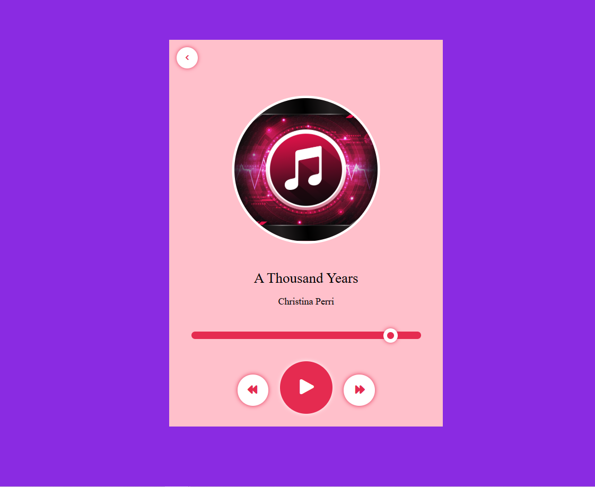

# 🎵 PurePlay — Desktop Web Music Player

A clean, minimalist desktop-first web music player designed with an elegant light aesthetic, fixed layout controls, and essential audio streaming features.

---

## 📸 Preview



---

## ✨ Features

- **Light Aesthetic:** Clean, high-contrast light theme with soft shadows and sharp typography.
- **Fixed Desktop Layout:** Streamlined, wide-canvas interface optimized for desktop viewports.
- **Audio Controls:** Play, pause, skip forward/backward, seeking, and volume adjustment.
- **Playlist & Queue:** Quick-access tracklist displaying titles, artists, and durations.
- **Real-Time Progress:** Dynamic seek bar reflecting elapsed and remaining track time.

---

## 🛠️ Built With

- **HTML5:** Semantic document structure
- **CSS3:** Custom light styling, typography, and fixed-width desktop layouts
- **JavaScript (ES6):** HTMLAudioElement control, playlist index state, and UI binding

---

## 🚀 Getting Started

### Prerequisites
A desktop web browser (Google Chrome, Microsoft Edge, Mozilla Firefox, or Safari).

### Setup
1. Clone the repository:
   ```bash
   git clone https://github.com/Imama1076/Music-Player.git
   ```

2. Open the project:
   - Navigate into the directory:
     ```bash
     cd Music-Player
     ```
   - Open `Music-player.html` directly in your browser or launch it using VS Code Live Server.

---

## 📂 Project Structure

```text
├── Music-player.html    # Entry landing page
├── song-selection.html  # Track list and player interface
├── style.css            # Styling and visual theme
├── script.js            # Playback logic and controls
├── songs/               # Audio tracks
└── previe1.PNG          # Application preview screenshot
```

---

## 👤 Author

- GitHub: [@Imama1076](https://github.com/Imama1076)
- Repository: [Music-Player](https://github.com/Imama1076/Music-Player)

